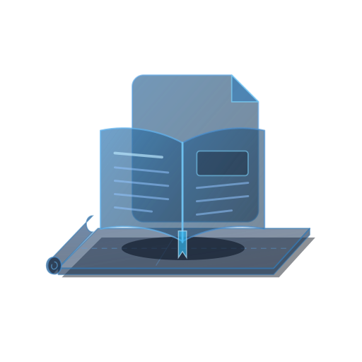

# DocuPad

<p align="center">
  
</p>

A fast, modern **Document Viewer, Reader, and Markdown/PDF Companion Application** with **Retina Vision** (HiDPI dynamic font scaling and subpixel anti-aliasing), **Document Outline Sidebar**, **Rendered Reader View & Source View**, **Multi-Tab Document Browsing**, and a translucent darker-blue open book and document watermark resting on an unassuming yoga pad. Built natively for **Linux Mint Cinnamon** using Python 3, GTK 3, GtkSourceView 4, and WebKit2.

---

## Key Features

### Multi-Format Document Viewing & Rendering
- **Rendered Reader View (`F6` / `Ctrl + P`)**: View Markdown (`.md`), reStructuredText (`.rst`), HTML (`.html`), CSV/TSV tables (`.csv`, `.tsv`), ODT (`.odt`), and DOCX (`.docx`) rendered with clean dark-neon typography, formatted tables, blockquotes, and code blocks.
- **High-DPI PDF Page Viewer (`.pdf`)**: Inspect PDF documents with crisp page-by-page rasterization (`pdftoppm` / `PopplerBridge`), zoom scaling, and instant text extraction (`pdftotext`) in Source View.
- **Interactive PDF Text Selection & Copying**: Click and drag across PDF pages to select text with translucent neon cyan highlight overlays; double-click selects words, triple-click selects full lines, `Ctrl + A` selects all text on the current page, and `Ctrl + C` (or right-click -> Copy) copies the selected text to the clipboard. Text selections automatically prime the system primary selection buffer.
- **Universal Hyperlink Navigation (`Ctrl + Click`)**: In PDF View, Source View, and Rendered Reader View, holding `Ctrl` over links transforms the cursor to a pointer hand and shows the destination in a tooltip. `Ctrl + Click` opens web and email links in the default browser, jumps to destination pages for internal PDF links, or opens linked local documents in a new DocuPad tab.
- **Source & Text View**: Inspect or edit the underlying document source with syntax highlighting, line numbers, and the translucent DocuPad yoga-pad watermark.
- **Read-Only Lock (`Ctrl + R`)**: Toggle read-only mode anytime to prevent accidental edits while reading documentation.

### Document Outline & Table of Contents Sidebar
- **Automatic Heading Extraction (`F9`)**: Automatically builds a hierarchical Table of Contents from Markdown headings (`#` through `######`), reStructuredText underlined sections, HTML `<h1>`–`<h6>` tags, JSON top-level keys, or PDF pages.
- **One-Click Section Jump**: Click any heading or page entry in the Outline sidebar to jump directly to that section or PDF page.

### Companion Integration with PythonPad
- **Open in PythonPad**: Launch the current file directly in PythonPad from *Menu -> Open in PythonPad...*
- **Unified Dark Mode & Neon Blue Aesthetic**: Matches PythonPad's dark slate UI (`#0b0f19`), crisp white text, neon cyan/blue accents (`docupad-neon`), and translucent yoga-pad emblem (`docupad.svg`).

### Retina Vision & Navigation
- **Dynamic Retina Zooming**: Scale both Rendered Reader View, PDF pages, and Source View fluidly from **50% up to 300%** using `Ctrl + +`, `Ctrl + -`, `Ctrl + 0`, or **`Ctrl + Mouse Wheel`**, with accurate real-time percentage indicators on the HeaderBar and Status Bar.
- **Full Page View on Launch (`F5` / `Ctrl + 9`)**: Double-clicking a PDF or compatible document file opens DocuPad maximized in Full Page View with the entire page fitted to the window and the outline sidebar tucked away for a distraction-free reading experience.
- **Interactive Mouse Grip & Panning**: When zoomed in on PDF documents, click and drag with the mouse to grip and smoothly pan around the page in any direction. Shows an open hand (`grab`) cursor when hovering over zoomed pages and an active gripping hand (`grabbing`) cursor while dragging.
- **Integrated Search & Replace (`Ctrl + F` / `Ctrl + H`)**: Live match counting, case sensitivity, whole-word matching, and regular expressions.
- **HTML Export**: Export any Markdown, RST, CSV, or text document to a standalone styled dark-mode HTML file (*Menu -> Export Document to HTML...*).

---

## Installation

```bash
./install.sh
```

The installer automatically:
- Installs the vector icon (`docupad.svg`) and multi-size panel icon set (`16x16` through `512x512`) into `~/.local/share/icons/hicolor/`.
- Installs the desktop launcher (`~/.local/share/applications/docupad.desktop`) with `StartupWMClass=docupad`.
- Creates the CLI command symlink at `~/.local/bin/docupad`.
- Registers DocuPad as the default viewer for `.md` and `.rst` files and pins DocuPad to your Cinnamon Menu favorites.

---

## Keyboard Shortcuts

| Shortcut | Action |
| :--- | :--- |
| `F6` / `Ctrl + P` | **Toggle Rendered Reader View / Source View** |
| `F9` | **Toggle Document Outline Sidebar** |
| `Ctrl + R` | **Toggle Read-Only Lock** |
| `Ctrl + T` / `Ctrl + N` | **New Document Tab** |
| `Ctrl + O` | **Open Document** |
| `Ctrl + S` / `Ctrl + Shift + S` | **Save / Save As** |
| `Ctrl + W` | **Close Current Tab** |
| `Ctrl + F` / `Ctrl + H` | **Find / Replace Bar** |
| `Ctrl + G` | **Go to Line** |
| `Ctrl + +` / `Ctrl + -` | **Retina Zoom In / Out** |
| `Ctrl + 0` | **Reset Retina Zoom (100%)** |
| `F5` / `Ctrl + 9` | **Full Page View / Fit Page** |
| `Page Up` / `Page Down` | **Previous / Next PDF Page** |
| `Scroll Wheel` | **Next / Previous PDF Page (in PDF View)** |
| `Home` / `End` | **First / Last PDF Page (in PDF View)** |
| `Ctrl + Scroll Wheel` | **Smooth Real-Time Zooming** |
| `Click + Drag` | **Select Text (on text) or Grip & Pan Page (on margins/zoomed PDF)** |
| `Middle Click + Drag` | **Grip & Pan Page Anywhere (when zoomed in on PDF)** |
| `Double-Click / Triple-Click` | **Select Word / Select Entire Line (PDF View)** |
| `Ctrl + Click` | **Follow Hyperlink (PDF, Source, and Reader Views)** |
| `Ctrl + C` | **Copy Selected Text to Clipboard** |
| `Ctrl + A` | **Select All Text on Page (PDF View)** |
| `Ctrl + Q` | **Quit Application** |
